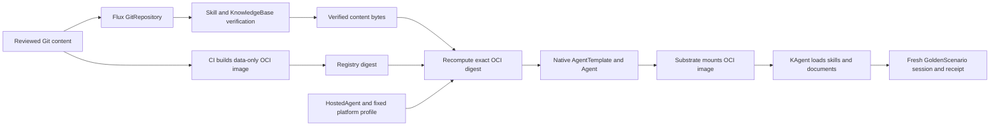

# Native KAgent 1.x content onboarding

This packaged source is the recorded lab implementation. Start the workplace POC with [POC-QUICKSTART.md](../../../../POC-QUICKSTART.md). Run the original source commands below from the bundle's `implementation/` directory. Current target deployment still needs its own receipt.

This adapter keeps the four platform request types while targeting KAgent `v1.0.0-alpha17` and Substrate `v0.6.0-alpha3`. It runs alongside the legacy implementation. It is a lab migration, not an in-place upgrade of the old databases or an Azure deployment.

`examples/requests.yaml` records the four requests used in the lab with real content and file hashes. `examples/profile.example.json` records their publication mapping with a registry placeholder. These commits belong to the disposable local Git fixture, not a public GitLab repository.

The follow-up [GoldenScenario v3](examples/golden-exact-citation.yaml) states the
required citation spelling in its prompt. The evaluator, release pins, file-byte
checks, and answer requirements are unchanged. Earlier scenarios remain retained.

Owners submit immutable `Skill`, `KnowledgeBase`, `HostedAgent` and `GoldenScenario` requests. Skill and knowledge content comes from a full Git commit through Flux. The content adapter verifies source revision, archive digest, selected file hashes, ownership and document provenance before creating an immutable ConfigMap. A distinct `runtimeProfile: lab-kagent-1x-v1` selects the native adapter.



`artifacts.py` builds a reproducible Linux/amd64 OCI manifest with one uncompressed USTAR layer, sorted complete paths, fixed metadata, 0755 directories and 0644 files. KAgent copies these files into its workspace and preserves modes; read-only directories prevent that copy on alpha17. No executable or Docker build is involved. Special OCI whiteout names, symlinks, ancestor/file conflicts and reserved wrapper/proof paths are rejected. The KnowledgeBase becomes a native skill with a generated `SKILL.md`; reviewed document bytes remain unchanged and are placed under `references/`. Native `load_skill_resource` accepts only `references/`, `assets/` or `scripts/` paths. Both packages contain `references/release-proof.txt`, a deterministic release proof that acceptance must read rather than receive in its prompt.

The platform-owned profile maps each release to an approved registry repository and direct manifest digest. It pins the complete release spec and GitRepository spec. The Hosted adapter recomputes the digest from verified content and rejects mismatches before creating children. It needs no registry credentials or Kubernetes Secret access. Native image pulls use the runtime's separately configured registry credentials. Production private-registry authentication still requires validation against the chosen GitLab installation.

HostedAgent creates only a native `api.kagent.dev/v1alpha3` AgentTemplate and Agent. The template name contains its spec digest. A changed template produces a changed Agent reference and generation, preventing stale readiness from an earlier generation. A mutated existing template fails closed. The platform profile fixes the namespace-local Harness and ModelConfig. Owner delivery can write only the four platform request kinds, not native Agents, profiles, Secrets or Harnesses. Content deletion waits while a HostedAgent or retained native template still references its release.

This lab reuses the existing `kagent` namespace, Harness `aks-docs-v1`, WorkerPool `kagent-default` and ModelConfig `flow-demo-model` on the fresh cluster. Another namespace needs its own WorkerPool, Harness, model route and credential policy. A profile is platform configuration, not an owner-controlled request. This is one platform trust domain and makes no multitenant isolation claim.

Bash is disabled and no Azure or MCP operational tools are attached. Upstream still advertises `write_file` and `edit_file`; instruction guards and observed read-only calls are not a full read-only security boundary. The materialized workspace copy is writable. Immutable Git and OCI pins prove approved input bytes, not protection against every subsequent runtime write.

## Observed lab result

The fresh generated `hosted-aks-docs-v1` passed GoldenScenario `aks-docs-v2`. Six native read calls loaded both complete skill instruction bodies and returned the exact catalog, runbook and two release proofs. The proofs were absent from the prompt. The prepared revision and dependency UIDs/specs stayed pinned before and after execution. `verification.json` is the sanitized receipt; full task/session evidence remains in the operator's private evidence directory.

Live negative checks rejected a wrong Git file hash, a wrong release pin and a foreign child collision. Content deletion was blocked while referenced and completed after detachment. Reconciliation preserved active child resource versions. Eleven live RBAC checks matched the allowed and denied operations. The content, native, Hosted, legacy Golden and knowledge suites passed 125 tests in total. Both old installations and yesterday's OTel deployments were freshly available after the migration.

The OTel follow-up passed GoldenScenario `aks-docs-v3` and correlated its task
with three native model calls, two `load_skill` calls, and four
`load_skill_resource` calls. Actor identity links resume, running, and suspend
events. The separate viewer retains recent native requests within its hard
limits and labels token totals as native runtime reports. Gateway observations
remain visible without adding their usage again. See
[verification-native-otel.json](verification-native-otel.json) and the
[native tracing guide](https://github.com/davidmarkgardiner/kagent-work-bundles/blob/main/otel-agent-flow/NATIVE-KAGENT-OTEL.md).
The viewer bundle passes 107 checks. Missing intermediate gateway parents remain
an explicit trace gap. Reboot recovery, node-loss recovery, live GitLab
publication/private pulls, automatic acceptance gating, and arbitrary BYO
runtimes remain unproven.

## Build and promote

Use Python 3.12 and Git. The publisher reads the exact Git object at `spec.sourceCommit`, not potentially modified checkout files. It rejects non-regular Git entries and compares all selected bytes with the release manifest.

```sh
python platform/skills-registry/native/publish.py \
  --git . --release deploy/reviewed-release.json --layout reviewed-layout
oras cp --from-oci-layout reviewed-layout:reviewed \
  '{{GITLAB_REGISTRY}}/{{GROUP}}/{{PROJECT}}/reviewed-aks-known-issues:{{PIPELINE_TAG}}'
```

The copy form is documented at https://oras.land/docs/commands/oras_cp/. Promote the emitted **digest**, complete release spec hash and Flux source spec hash into the platform profile through the platform GitOps repository. Never substitute a mutable tag in an AgentTemplate. CI emits a proposal; Flux owns delivery. The example pipeline in `gitlab-ci.example.yml` builds on ordinary pipelines and publishes only protected refs. It contains no Kubernetes credentials or apply step. Copy the publisher, `artifacts.py` and parent `controller.py` with their directory structure into the content repository if it is separate. Its reviewed release JSON must already pin a reachable full content commit. Run a matrix or separate jobs for multiple releases.

GitLab authentication and artifacts documentation are https://docs.gitlab.com/user/packages/container_registry/build_and_push_images/ and https://docs.gitlab.com/ci/yaml/artifacts_reports/. No live GitLab pipeline has been claimed or created by this lab proof. A target project, writable CI route and private pull configuration must be supplied before that part can be verified.

## Render and verify

A platform operator renders a reviewed profile before bootstrapping. Do not apply unresolved placeholder examples. CRDs and adapters are installed by the platform; owner requests are reconciled by namespaced Flux with the restricted `skills-gitops` account.

```sh
python platform/skills-registry/native/resources.py \
  --profile '{{REVIEWED_PLATFORM_PROFILE_JSON}}' --namespace kagent > native-platform.json
kubectl --kubeconfig '{{NEW_CLUSTER_KUBECONFIG}}' apply --dry-run=server -f native-platform.json
```

`GoldenScenario` policy `aks-docs-kagent-1x-v1` is a manual live acceptance contract. It requires one freshly created session, exact native skill instruction bodies, exact reference/runbook/proof file responses, both release proof values, required answer terms and source citations. It pins dependency UIDs/specs before and after the run and requires the session's prepared revision to match the current Ready Agent. It rejects unexpected tools and unmatched or duplicate tool results. A synthetic envelope unit test is only an evaluator test; a real run produces a separate receipt.

```sh
python platform/skills-registry/native/run_golden.py \
  --kubeconfig '{{NEW_CLUSTER_KUBECONFIG}}' --cli '{{KAGENT_ALPHA17_BINARY}}' \
  --config '{{KAGENT_CLI_CONFIG}}' --scenario aks-docs-v3 --output '{{NEW_EVIDENCE_DIRECTORY}}'
python -m unittest discover -s platform/skills-registry/native -p 'test_*.py'
```

GoldenScenario does not automatically gate agent exposure or schedule future runs. Lifecycle spans are separate evidence from native tool results. The OTel receipt proves the tested documentation request, not every runtime or recovery path. Reboot recovery and node-loss recovery are not implied by a successful documentation answer. Failed prototype templates and their history are retained; detaching a release requires removing its HostedAgent and retained templates through an approved GitOps cleanup.
