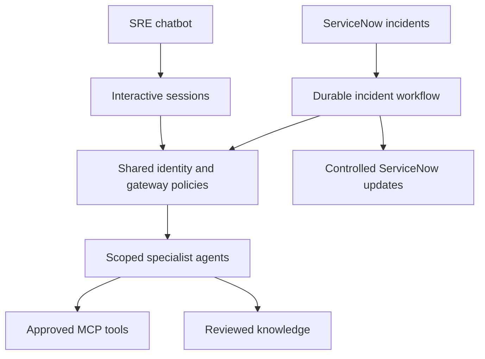

# AI Platform Pod: Direction and Delivery Plan

**Status:** Proposal for product-owner and engineering discussion.

**Prepared:** 17 November 2026.

**Planning horizon:** Remaining calendar Q4 2026 and Q1 2027. Adjust the dates if the organisation uses different fiscal quarters.

**Capacity:** One Pod Tech Lead and three engineers, supported by AI-assisted engineering.

## Direction in one paragraph

The pod provides a secure, governed way for teams to deploy and consume agents using kagent, agentgateway and KRO. Its first operational use case is ServiceNow incident investigation: gather relevant evidence, consult reviewed guidance and give SREs timely, useful ticket updates. Secure onboarding is a reusable platform service. ServiceNow automation and the SRE chatbot are separate consumers of that service, with their own identities, execution state and operational ownership.

This document proposes priorities and acceptance criteria. It does not establish workplace deployment, production readiness, agreed service levels or approval to change infrastructure. Existing public demonstrations and lab receipts are reference material; receiving-environment verification remains necessary.

## 1. Pod remit and ownership

The Pod Tech Lead translates a prioritised milestone into an achievable technical delivery plan: define architecture boundaries, resolve dependencies, guide implementation, agree acceptance evidence and explain trade-offs to the product owner. The product owner prioritises outcomes and scope. Engineers own implementation and peer review. AI assists with groundwork; accountable engineers verify changes and results.

| Area | Proposed ownership |
|---|---|
| Secure agent onboarding, gateway integration, supported profiles and tool-access contracts | AI platform pod |
| ServiceNow investigation integration and execution lifecycle | AI platform pod, with ServiceNow and SRE partners |
| SRE chatbot interface and conversational journeys | SRE product/team |
| Domain-agent behaviour and specialist guidance | Named agent/service owner, using platform contracts |
| Runbook accuracy, incident decisions and resolution | Relevant service owners and SRE |
| Identity grants, security requirements and exceptions | Identity/security owners, integrated through controlled onboarding |

The initial offering supports a small set of reviewed agent profiles. Arbitrary runtimes, unrestricted tool installation and general autonomous remediation require separate design and acceptance work.

## 2. Architecture: shared platform, separate consumers

The diagram is conceptual. It does not prescribe every network hop or imply that a gateway identity automatically authorises downstream resource access.

Both consumers can reuse specialist agents, approved model routes, tool contracts, knowledge releases and telemetry. Each needs distinct caller identity, permission scope and execution records. Shared infrastructure can enforce separate policies; separate products do not necessarily require separate clusters.

The incident workflow owns durable state, deduplication, bounded retries, timeouts and ticket updates. The chatbot owns interactive sessions and user-directed exploration. ServiceNow processing must continue when the chatbot is unavailable. An incident workflow should invoke only the specialists needed for that case, rather than fan out to every available agent.

## 3. Platform milestone: Entra-backed BYO agent onboarding

Build on the secure KRO composition and add Microsoft Entra identity integration. KRO composes reviewed Kubernetes resources; identity grants and federation changes require explicitly owned automation and appropriate authority. Do not assume that supplying a UAMI identifier proves ownership or grants permission to bind it.

### Onboarding request

A team supplies an accountable owner, approved UAMI reference, intended callers, supported agent profile/version, requested tools and resource scopes, approved model, usage limits and support contact. The platform validates these inputs against a reviewed catalog and delivers approved desired state through the existing GitOps process. The pod's own incident agent should consume the same onboarding service.

### Separate the permission boundaries

| Boundary | Required decision |
|---|---|
| Caller to agent | Which human or workload identity may invoke this agent? |
| Agent to MCP/API | Which operations may this workload request, using which downstream identity and token audience? |
| MCP/API to resource | Which clusters, namespaces, repositories or data may the backend access? |

Entra Workload Identity/UAMI and Microsoft Entra Agent ID are distinct design choices. Agree which identity model is required for each hop. Delegated user access needs its own reviewed flow; caller authentication must not silently become outbound tool permission. Authentication does not replace resource-level authorisation.

### Completion evidence

- One pod-owned agent onboarded through the supported process and able to complete one approved read.
- Missing, expired, wrong-issuer, wrong-audience and unauthorised caller/role tokens denied.
- Cross-agent tool access, out-of-scope resources and direct-backend bypass attempts denied.
- Verified ingress and egress restrictions on the receiving network implementation.
- Tested disable/revoke path and re-verification when identity, tools, model, prompt or skill release changes materially.
- Correlated caller, agent, model and tool evidence, with credentials excluded from logs.

Verify the actual kagent, agentgateway, KRO, CRDs and identity configuration before implementation. Latest upstream examples are references rather than installed-version proof.

## 4. Operational milestone: ServiceNow investigation pilot

Choose one incident queue and two or three frequent incident patterns with SRE. Start with evidence gathering and diagnostic/change guidance. Treat ticket text and retrieved content as untrusted input; neither can expand tool permissions or select arbitrary resource targets.

### First end-to-end journey

1. Receive an authenticated incident event and validate its payload and eligibility.
2. Resolve the affected service, cluster and namespace through trusted inventory mappings. If the target is ambiguous, request missing information or hand over.
3. Persist the incident/event correlation and append a deterministic acknowledgement.
4. Invoke the required specialist agents for bounded, read-only investigation and retrieve relevant reviewed guidance.
5. Produce a structured result containing observed facts, likely explanations, missing evidence, source links, timestamps and recommended next checks.
6. Apply the agreed content and review policy, append the appropriate ticket update and hand over to the SRE.

Cluster reads and ticket writes have separate permissions. A narrowly scoped ticket-update component controls the incident identity and permitted fields. Internal work notes and customer-visible comments follow separate publication rules. Begin diagnostic updates with SRE review; introduce automatic publication only within an agreed policy.

Use durable execution state, bounded retry policies and idempotency controls. Test duplicate events, update-triggered event loops, partial failures, timeouts and ambiguous write outcomes so retries cannot create duplicate ticket comments. Unsupported cases and unavailable tools must produce explicit handoffs. Existing human incident handling remains available if AI services fail.

### Remediation progression

The first release gathers evidence and recommends action. A later release may draft reviewed GitLab changes or submit a fixed, approved workflow. Resource-changing permissions belong to the execution workflow's service account; the conversational agent does not receive general cluster-write access. Broader remediation requires separate product priority, security acceptance, rollback design and operational proof.

## 5. Knowledge and skills that improve over time

| Content | Purpose | Publication approach |
|---|---|---|
| Skills | Procedures for investigating a particular problem | Reviewed, versioned packages pinned to an approved release |
| Knowledge articles | Architecture, known issues, ownership and runbooks | Authoritative source, citations, access controls and review dates |
| Incident records | Findings and actions that actually worked | Redacted, evidence-linked records with retention rules |
| Conversational memory | Context retained for an agent/user | Separate scope and lifecycle from the shared knowledge service |

Current kagent documentation describes agent memory using PostgreSQL/pgvector, scoped to the agent and user. That does not by itself provide a shared, governed operational knowledge service. Check the workplace version and configuration before selecting the implementation.

The existing experimental Skills/KnowledgeBase bundle provides a starting point for versioned file delivery through Git/Flux and immutable content. Its file-based KnowledgeBase path does not provide vector search. It is a project-specific pattern, not a claim that those CRDs are standard upstream kagent APIs.

Start with a small, curated set of articles supporting the selected incident patterns. Reuse an established enterprise knowledge source where one exists; preserve its ownership and access policy. Add indexed/vector retrieval when corpus size and measured retrieval needs justify it. Retrieval must filter by caller/workload entitlement and return bounded, cited results.

### Improvement cycle

**Resolved incident -> proposed lesson or article change -> service-owner review -> evaluation -> versioned release.**

Agents can identify gaps and draft updates. A named owner approves promotion into trusted guidance. Each article carries provenance, applicability, owner, review date and version. Support withdrawal and re-indexing when guidance is superseded or access changes. Measure retrieval relevance and incident usefulness rather than article count alone.

## 6. Proposed Q4 2026 and Q1 2027 outcomes

These are discussion targets, dependent on available capacity, identity permissions, ServiceNow access, representative incidents and partner support. Protect the secure-onboarding milestone first if the remaining Q4 window is constrained.

| Period | Outcome | Acceptance |
|---|---|---|
| Remaining Q4 2026 | Entra-backed onboarding pilot | One pod-owned agent uses the supported process; allowed access, denial, revocation and trace evidence captured |
| Remaining Q4 2026 | ServiceNow pilot ready to build | One queue, 2-3 patterns, trusted target mapping, payload contract, update policy and baseline measures agreed; representative incidents replayable |
| Q1 2027 | Controlled incident-triage pilot | End-to-end investigations and ticket updates, initially reviewed by SRE, with duplicate handling, explicit failures and manual handoff |
| Q1 2027 | Reusable platform offering | A second team onboards without bespoke security design; versioned knowledge and evaluation releases support both consumers |

### Pilot measures to agree after baselining

| Measure | Starting proposal | Measurement boundary |
|---|---|---|
| Acknowledgement latency | Within one minute | Successful ingestion to confirmed ticket acknowledgement |
| Useful triage latency | Within five minutes for supported cases | Successful ingestion to an SRE-usable investigation result; also report timeouts and exclusions |
| Summary quality | At least 80% accepted without material correction | Supported-case results reviewed against an agreed SRE rubric |
| SRE effort | Demonstrated reduction in investigation time | Compare representative cases with the manual baseline |
| Traceability | Every pilot run has an identifiable outcome | Include failures, denials, timeouts and ticket-update receipts |
| Cost | Visible cost per useful investigation | Include model usage, repeated attempts and failures |

These are proposed pilot targets, not measured results or service-level commitments. Report sample size, incident mix and unsupported-case rate. Avoid claiming an MTTR improvement until the pilot can distinguish investigation savings from wider incident-resolution effects.

## 7. Four-person delivery model

| Role | Primary responsibility |
|---|---|
| Pod Tech Lead | Architecture, dependencies, stakeholder alignment, scope and acceptance evidence |
| Engineer 1 | Onboarding, identity integration and gateway policy |
| Engineer 2 | ServiceNow contracts, durable execution and controlled updates |
| Engineer 3 | Knowledge delivery, evaluation fixtures and supporting telemetry |

These are responsibility areas rather than isolated projects. Pair on reviews, keep one major delivery milestone active at a time and reserve capacity for integration, support and receiving-environment verification. Knowledge, evaluation and telemetry should land with each vertical delivery slice.

Use AI for research, scaffolding, fixtures, draft documentation and review assistance. Engineers own acceptance, dependency decisions and live proof. Count completed outcomes from reviewed changes and observed results.

## 8. Adjacent opportunities, in priority order

1. **Evaluation and release gates:** Replay representative incidents when prompts, models, skills or tools change. Include misleading evidence, malicious ticket instructions and unavailable dependencies.
2. **Cost and reliability controls:** Measure queue age, latency, tool failures and cost per useful result. Enforce bounded concurrency, time/token budgets and manual handoff.
3. **Agent inventory and lifecycle:** Record owners, identities, tools, models, knowledge versions, review dates and disable/revoke procedures.
4. **Change guidance:** Correlate incidents with recent deployments and draft reviewed GitLab changes or approved workflow requests.

Treat these as capabilities supporting the two delivery tracks. Prioritise a separate programme only when adoption or measured operational needs justify it.

## 9. Decisions for the product-owner discussion

- Agree the pod remit and ownership split with SRE, ServiceNow, identity/security and service owners.
- Prioritise one repeatable onboarding path and one narrow incident journey before expanding the agent catalog.
- Nominate the first incident queue, 2-3 patterns and SRE reviewer; obtain representative, sanitised evaluation cases.
- Confirm the installed platform versions, required identity model, identity-administration owner and access dependencies.
- Choose the authoritative knowledge source and who approves changes; begin with the smallest useful corpus.
- Agree internal versus customer-visible ticket-update rules and the pilot review stages.
- Accept the capacity trade-off: wider remediation, arbitrary BYO runtimes and ownership of the SRE chatbot need additional prioritisation.
- Review the pilot using adoption, quality, SRE time saved, reliability and cost; use that evidence to choose the next milestone.

## 10. References and evidence boundaries

Public project reference bundles:

- [Secure KRO/classic kagent composition and planned identity follow-ups](https://github.com/davidmarkgardiner/kagent-work-bundles/tree/main/secure-kro-classic-kagent)
- [Experimental versioned Skills/KnowledgeBase bundle](https://github.com/davidmarkgardiner/kagent-work-bundles/tree/main/agent-platform-four-crds)

Official documentation checked during the direction review on 17 November 2026:

- [Microsoft Entra Workload ID on AKS](https://learn.microsoft.com/en-us/azure/aks/workload-identity-overview)
- [agentgateway authorisation](https://agentgateway.dev/docs/kubernetes/latest/documentation/security/authorization/)
- [kagent agent memory](https://kagent.dev/docs/kagent/latest/agents/agent-memory/)
- [kagent 0.x agent memory](https://kagent.dev/docs/kagent/0.x/concepts/agent-memory/)

Documentation URLs can advance with upstream releases. Match schemas and runtime behaviour to the receiving installation. Historical lab receipts prove only their named scenarios and environments. This proposal includes no new workplace runtime, Entra enforcement, ServiceNow write or remediation proof.
