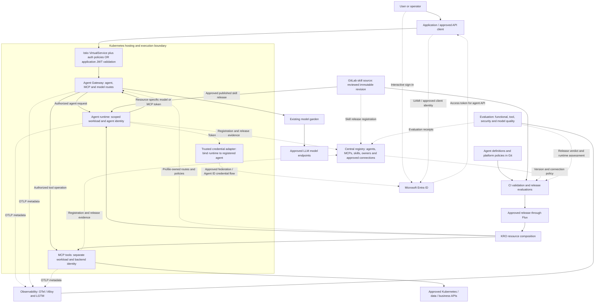
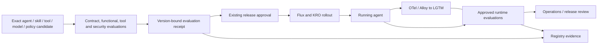

# DICE solution concept design

Status: proposed target architecture for workplace review. Date: 11 November 2026. This document describes the intended service and its acceptance evidence. It does not certify a workplace implementation. [ADR-0001](ADR-0001.md) records the decisions. [The offline diagram viewer](index.html) provides printable overview, authentication and evaluation views.

## Purpose

A team declares an agent through GitOps, consumes an authenticated API, and uses approved skills, MCP tools and models. The platform supplies identity boundaries, release controls, observability and evaluation. Agents and MCP servers run in Kubernetes under separate identities and permissions. Their logical proximity does not imply permission to connect.

## Logical architecture

Solid arrows below carry requests or content. Dotted arrows describe identity, governance, delivery or telemetry relationships. Entra issues resource-specific access tokens. The receiving gateway/API validates and authorizes them. [Microsoft documents that resource-server responsibility](https://learn.microsoft.com/en-us/entra/identity-platform/access-tokens).



MCP servers may already be shared platform services. Their normal delivery owner retains them; the agent's KRO owner does not automatically own or recreate those shared services. The KRO-to-MCP arrow represents the applicable platform delivery graph, not mandatory per-agent ownership.

The model garden is the existing inference backend connected to approved LLM endpoints. Gateway model bindings preserve that service contract and its governance. This SCD does not move agent hosting to a model provider. The repository's [current model-provider decision](https://github.com/davidmarkgardiner/kagent-public/blob/cee273b05d3d08d13c7d44044dc93e791cf1e82a/docs/foundry-current-service/README.md) separately considers provider replacement.

## Components and responsibilities

| Component | Responsibility |
| --- | --- |
| Application/client | Authenticate its user where applicable, obtain the correct destination token, invoke the approved agent API and preserve request correlation. |
| Entra ID | Issue tokens and manage the registered identities, federation and approved API permissions. |
| API exposure | Publish the approved HTTPS endpoint and require the selected authentication/authorization contract. |
| Agent Gateway | Enforce configured caller, agent, tool and model route policies, limits and telemetry. |
| Agent runtime | Execute reviewed instructions and native skills; invoke only approved capabilities through the controlled routes. |
| Trusted credential adapter | Bind a verified runtime identity to its permitted agent principal and acquire destination tokens outside model context. |
| MCP server | Enforce bounded typed operations and use its own least-privilege backend identity. |
| Central registry | Record ownership, immutable releases, approved identity/connection references, evaluation status and lifecycle. It stores no credential material. |
| GitLab skills | Hold reviewed skill instructions, references and provenance. The release pipeline publishes the exact approved content to the runtime. |
| Model garden | Supply the approved model choices and inference endpoints behind the selected Gateway binding. |
| OTel and LGTM | Correlate request metadata, spans, logs, metrics and reported usage through the approved collection path. |
| Evaluation service/jobs | Produce functional, tool, security and quality verdicts tied to the exact release; assess runtime outcomes under approved data handling. |

## Caller-to-agent authentication

```mermaid
sequenceDiagram
    participant User as Human / operator
    participant App as Application with UAMI
    participant Entra as Entra ID
    participant API as Protected API / Agent Gateway
    participant Agent as Agent runtime
    User->>App: Interactive sign-in when a user is present
    App->>Entra: Authenticate workload; request agent-API access
    Entra-->>App: Access token for the agent API
    App->>API: Invoke agent over HTTPS with that token
    API->>API: Validate signature, issuer, time, audience and caller permission
    API->>API: Authorize this caller for this agent and operation
    API->>Agent: Route accepted invocation with trusted correlation
    Agent-->>App: Native task/result through the protected API
```

A UAMI represents the calling workload. A human signs in through an approved interactive client. For the default service-to-service path, the application authorizes the user and invokes the agent under its UAMI. That does not carry the user's delegated permissions downstream. A direct delegated client or OBO profile needs explicit API scopes and consent. The API must distinguish token types correctly; a delegated token can also contain user roles. [Application/delegated token guidance](https://learn.microsoft.com/en-us/troubleshoot/entra/entra-id/app-integration/application-delegated-permission-access-tokens-identity-platform) and [OBO guidance](https://learn.microsoft.com/en-us/entra/identity-platform/v2-oauth2-on-behalf-of-flow) establish these separate flows.

For an AKS UAMI caller, use the approved Workload Identity federation path. The federation assertion's audience and the final agent-API token's audience serve different purposes. The installed AKS federation mode must be selected explicitly; identity bindings and direct federation use different assertion audiences. [AKS Workload ID guidance](https://learn.microsoft.com/azure/aks/workload-identity-overview)

## Agent-to-MCP authentication

```mermaid
sequenceDiagram
    participant Agent as Verified agent runtime
    participant Broker as Trusted credential adapter
    participant Entra as Entra ID
    participant GW as Agent Gateway
    participant MCP as Approved MCP service
    participant Data as Backend API
    Agent->>Broker: Request access to an approved destination
    Broker->>Broker: Bind runtime to its registered agent identity
    Broker->>Entra: Acquire destination token through approved identity flow
    Entra-->>Broker: Agent access token for the MCP API
    Broker-->>Agent: Transport credential outside model context
    Agent->>GW: MCP operation plus resource-specific token
    GW->>GW: Validate identity, audience, permission and tool policy
    GW->>MCP: Forward approved operation through trusted service path
    MCP->>MCP: Validate trusted caller context; enforce arguments and output limits
    MCP->>Data: Use the MCP service's scoped backend identity
    Data-->>MCP: Bounded result
    MCP-->>Agent: Result through Gateway
```

Use Entra Agent ID for the agent principal where the receiving integration supports the approved blueprint/agent token flow. A blueprint credential and its child agent identity have different roles in token acquisition. Use the supported credential adapter and target-resource permission model, rather than treating the child identity as an ordinary independent managed identity. [Autonomous Agent ID authentication](https://learn.microsoft.com/en-us/entra/agent-id/autonomous-agent-authentication-authorization-flow)

An approved per-agent workload UAMI is an alternative principal profile. Record which profile is in use. Keep the caller application's UAMI, agent principal and MCP backend identity separate. The broker maps an attested runtime to permitted identities and audiences; an agent prompt cannot select another agent's principal or obtain blueprint credentials.

For every protected resource, record the accepted issuer/tenant, audience, application role or delegated scope, principal/client restrictions, route and operation. Do not replay an agent-API token to an MCP API with a different audience. Model routes use their own accepted caller contract. Gateway authenticates to the model garden using its approved identity. The garden or provider adapter owns downstream model credentials.

## API exposure choices

**Istio-managed exposure.** A Gateway/VirtualService supplies HTTPS ingress and routing. JWT validation plus an authorization policy requires the approved principal/permission. A routing object alone supplies no authentication. Configure missing-token rejection and verify it on the installed version. [Istio RequestAuthentication](https://istio.io/latest/docs/reference/config/security/request_authentication/) and [AuthorizationPolicy](https://istio.io/latest/docs/reference/config/security/authorization-policy/)

**Application-managed exposure.** The owning API validates Entra access tokens and enforces its permission contract. If that API is a middle tier, it obtains the agent API's destination token using its approved UAMI or separately designed delegated flow. It does not forward a token intended for a different API. The Gateway still enforces the configured agent, MCP and model boundaries.

Select one authoritative exposure profile per route and document all enforcement points. Both profiles require private backend paths and rejection of unauthorized direct access. Keep admin, controller, OTLP and tool listeners out of the caller ingress.

## Registry, GitOps and skill lifecycle

The central registry contains separate records for agents, MCP services and skills. An agent record references its owner, runtime/profile version, instructions digest, approved skill releases, tool operations, model binding, API audience, identity binding, connection policy and evaluation receipts. MCP records identify their API contract, operation limits, audience, backend owner and approved identity requirements. Skill records identify the GitLab commit, content digest, publication artifact and owner.

Registry approval becomes enforceable through reviewed delivery/admission/runtime policy. A record alone grants no network access, API permission or compliance status. Publish changes through the existing GitOps process. Flux applies the reviewed revision and KRO composes the appropriate owner resources. Credential values remain in the approved identity/secret service, outside Git and registry records.

For retirement, close permitted access and revoke the relevant runtime policy through the normal process, then remove owned resources and verify pruning. Do not assume a registry status change instantly invalidates an already issued token. Preserve bounded token lifetime and a route-level deny/revocation mechanism.

## Observability and evaluation

These are adjacent operating capabilities with different outputs. OTel/Alloy exports approved telemetry to Loki logs, Grafana views, Tempo traces and Mimir/Prometheus metrics. Evaluation consumes approved test/runtime evidence and produces a release or assessment verdict. A trace is evidence of operations, not a quality score.



Release evaluation covers expected task behavior, source/skill use, tool arguments and enforced result limits, allowed/denied identity paths, direct-path isolation, error behavior and model compatibility. A PONG or Ready condition does not replace those checks. Tie the verdict to immutable agent, instruction, skill, tool, model-route, policy and evaluator versions. Re-evaluate material changes before promotion.

Runtime evaluation can use approved sampling or explicit cases, with its own identity, model/tool permissions, data policy and spend bounds. Prefer metadata-only telemetry. Content-based quality evaluation needs separately approved access to the selected inputs/results; metadata alone cannot score answer correctness. Do not log credentials, full prompts or tool bodies by default. Evaluation findings support review and the existing promotion/rollback process; this SCD does not grant an evaluator production write authority.

## Kubernetes isolation and acceptance

Use scoped workload identities, separate service accounts for agents and tools, minimal RBAC, read-only skill mounts, pod hardening, approved execution isolation and network paths that require the Gateway. Restrict internal controller and credential-broker access. Avoid giving untrusted agent code a shared blueprint credential or unrestricted Kubernetes token. Native shell/filesystem tools require explicit runtime controls, not only instructions asking the model to behave.

Acceptance records must demonstrate the exact Flux revision, current owner/runtime state, protected invocation, native skill/MCP records, independent backend completion, correlated telemetry, release evaluations and positive/negative authorization. Include no-backend-execution evidence for rejected requests and test direct-path isolation from the actual execution context. [The rehearsal record](../REHEARSAL-RECORD.md) captures these results.

The stored 11 November demo establishes a narrower runtime example with synthetic MCP data. Its direct deployment, permissive namespace network configuration and portal inspection do not establish this complete target architecture. The workplace agent must fill the receiving-system gaps before marking this SCD implemented.
