# Kyverno application companion and critical-only investigation

Status on 1 November 2026: implementation and integration proof in progress.
A dedicated local Kyverno cluster has passed a real policy regression and
application rollout recovery test. The combined classifier, native agent,
GitLab, GitOps, observer, and OTel demonstration still requires live integration.

David reports that the workplace agent has the earlier synthetic application
fault, kagent investigation, GitLab rollback, and visual display working.
Preserve that implementation as the starting point. Its latest source and
runtime receipts have not been inspected from this checkout.

## Deploy the specialist with its application

Package a companion with an application's Helm or GitOps release. For the first
application, install Kyverno with an associated telemetry profile, collector
configuration, classifier admission rules, and Kyverno specialist. The agent
runs in the existing kagent runtime. It has its own identity and tool grants.

Keep the collector and agent outside Kyverno's admission-controller pods.
Admission must keep working when the classifier or agent is unavailable.
The collector must also survive a Kyverno rollout so that it can observe a
failed upgrade and subsequent recovery.

Kyverno can later enforce the opt-in application's required profile, labels,
and permissions, or generate reviewed companion resources. Prove the companion
first. Automatically adding an agent sidecar to every pod would multiply
instances and does not establish access to Kubernetes Events or other pods' logs.

```mermaid
flowchart LR
    Release[Application GitOps release] --> Kyverno[Kyverno]
    Release --> Profile[Versioned application profile]
    Kyverno --> Signals[Selected events, logs and health evidence]
    Profile --> Filter[Scope, redaction, correlation and budgets]
    Signals --> Filter
    Filter --> Classifier[Bounded classification model]
    Classifier --> Admission[Critical-only admission and durable ledger]
    Admission --> Specialist[Kyverno kagent specialist]
    Specialist --> MR[GitLab proposal and exact-head CI]
    MR --> Reviewer[Independent read-only reviewer]
    Reviewer --> Human[Human decision on exact revision]
    Human --> GitOps[Merge and GitOps reconciliation]
    GitOps --> Probes[Verify valid admission and retained enforcement]
    Probes --> Signals
    Specialist -. actual execution spans .-> OTel[Existing OTel collector and dashboard]
    GitOps -. actual revision receipts .-> Recovery[Recovery view in the same dashboard]
    Probes --> Recovery
    OTel -. exact incident, task and span identity .-> Recovery
```



## Reuse the working kagent path

The original artifacts are in the sibling `durable-pi` checkout:

- `work-agent-bundles/remote-kagent-pi-demo/README.md` describes the original
  native 1.x Pi-pane bundle.
- `work-agent-bundles/remote-kagent-pi-demo-WORKPLACE-ADDENDUM.md`, dated
  16 October, supersedes its Pi and Substrate requirements for the workplace.
  It requests adaptation to the existing regular agents and interface.
- `apps/kagent-hub-bridge/GITLAB-ROLLBACK.md` records the original lab
  application, review, human approval, GitLab, Flux, and verification sequence.
- `work-agent-bundles/remote-kagent-pi-demo/runtime/classifier.py` uses a
  scripted HTTP-status decision. It is not a classification model.

The recent workplace code is the authority for its deployed A2A, UI, approval,
and GitLab adapters. Do not copy the old 1.x gRPC/session assumptions onto it.
Discover its installed CRDs and working agent declaration before rendering a
new specialist. Do not reintroduce Pi or Substrate just to match the old bundle.

The local patterns in
[`aks-platform-triage-specialists`](../../work-agent-bundles/aks-platform-triage-specialists/README.md)
provide scoped collection and stable identity guidance. Reuse the workplace
Alloy, Vector, Kafka, and Argo path if already present. A new full telemetry
stack is not a prerequisite for one application companion.

## Own one versioned application profile

The release owns these settings. The profile is configuration, not a new CRD
requirement for this iteration.

| Setting | Initial Kyverno contract |
| --- | --- |
| Application identity | Stable cluster identity, Kyverno release, namespace, controller identity, and owner. |
| Telemetry scope | Named Kyverno controllers, selected event reasons, bounded log signatures, and named health probes. |
| Desired state | GitLab project, branch, exact policy path, deployment owner, and approved healthy revision. |
| Knowledge | Installed Kyverno version, matching policy APIs, Helm values, topology, webhook behavior, troubleshooting runbooks, and policy tests. |
| Model route | Existing approved classifier and specialist routes, explicit input/output limits, and durable allowances. |
| Investigation tools | Fixed read operations for selected controller health, policies, webhook configuration, events, bounded logs, Git revision, and CI. |
| Remediation | Only the reviewed GitLab path and scoped execution service. No general shell or cluster apply/delete tool on the agent. |
| Verification | Positive and negative admission probes plus GitOps revision and policy readback. |

Record the actual knowledge revision and a runtime retrieval receipt. A file
listed in a profile is not proof that the specialist loaded or used it.

## Admit only an explicit critical condition

Start with one allow-listed condition: a known-good admission probe repeatedly
fails because of the selected Kyverno policy revision. The dedicated test
namespace represents a critical deployment path. That label describes the
synthetic scenario, not measured production business impact.

Suggested initial limits are deliberately conservative and require calibration:

| Gate | Proposed initial value |
| --- | --- |
| Scope | One release, one test namespace, one policy, one rule, one incident type. |
| Persistence | Three distinct failed probe observations spanning at least 60 seconds, all within two minutes. Replayed events do not count. |
| Corroboration | Policy-specific denial of the known-good probe plus current policy revision. A generic Warning, ERROR, or denied invalid request is insufficient. |
| Classifier decision | Structured `investigate`, internal severity `critical`, confidence at least 0.95, supported cause, and matching evidence IDs. |
| Evidence | At most 16 KiB of redacted evidence per candidate. Retain raw evidence separately under approved access. |
| Classifier allowance | At most 12 requests per demo run, at most 512 output tokens per request, and an enforced total input/output allowance on the approved route. Reserve allowance before sending. |
| Specialist admission | One admitted incident per demo run, one active investigation, with the existing enforced specialist allowance preserved. |
| Duplicate handling | One active episode per stable fingerprint. Coalesce further observations rather than creating tasks. |
| Rearming | Explicit fresh demo run after verified recovery. Do not reset durable ledgers during a restart. |

These are proposed settings, not measured false-positive rates. A model's 0.95
score is not a calibrated guarantee. The deterministic gates constrain what
the model may admit. A model cannot widen namespace scope, choose tools,
approve remediation, or turn a lower-severity record into an allowed incident.

Normal policy enforcement, successful admissions, routine background results,
single transient errors, and unrelated application logs remain outside the
classifier path. Record counts and suppression reasons so that low traffic is
distinguishable from a broken collector.

Classify fresh candidate windows rather than each log line. Missing model
results, malformed output, unavailable telemetry, and exhausted budgets produce
`unverified` or `blocked` states with operator-visible health. They do not mean
healthy and do not authorize an automatic agent call. Existing non-AI critical
alerting remains independent of this experimental classifier.

Kyverno reports describe current policy results rather than incident history.
Rejected resources do not provide a complete failure stream through reports.
Discover whether the installation uses `wgpolicyk8s.io` or `openreports.io` and
combine the relevant sources with actual admission probes and controller health.
Keep internal incident severity separate from policy-report severity.

## Persist the incident and dispatch evidence

Use the working deployment's durable storage. If a new admission ledger is
needed, one replica with transactional persistent storage is sufficient for the
first proof. Do not claim host-loss or highly available recovery from a PVC.

The incident record carries a schema version, profile revision, run ID, stable
fingerprint, episode ID, observation times, source record IDs, policy/rule
identity, Git and policy revisions, bounded evidence references, classifier
decision, usage, and the observed kagent message/task binding.

Fingerprint the cluster, application/controller, incident type, and policy/rule
identity. Keep changing pod names, log text, observation timestamps, Git SHAs,
and Kubernetes resource versions in evidence rather than the fingerprint.
Restarting or replacing a pod must not create a new incident automatically.

Track a persisted state machine:

```text
observing -> candidate -> classified -> dispatch_pending -> investigating
investigating -> proposed -> reviewed -> awaiting_human -> reconciling -> verified
```

Every transition requires its matching receipt. Preserve rejection, failure,
unknown dispatch, and uncertain write outcomes explicitly. Commit the incident
and its dispatch request together before contacting kagent. After a timeout,
read back the original request identity. If the deployed API cannot establish
whether delivery occurred, stop in an unknown state for reconciliation. Do not
claim exactly-once delivery or issue a fresh task blindly.

Neither a model answer nor a successful HTTP send establishes admission.
Record the actual accepted message/task identity. Bind review and the human
decision to the exact GitLab MR head and successful CI revision. Preserve the
working system's independent approval ledger and uncertain-merge handling.

## Prove a real fault without weakening enforcement

Use a fresh test namespace and a namespaced policy that matches only the
explicit fixture. Keep system, kagent, collector, and Kyverno namespaces outside
its scope. Run the fault from a bounded operator/test workflow with a cleanup
plan. The specialist does not have authority to start faults.

1. Record the cluster context, Kubernetes and Kyverno versions, chart version,
   images, policy API, ready agents, tool discovery, GitOps owner, model routes,
   and available durable allowances.
2. Establish a healthy baseline. A known-good fixture passes server-side
   admission. A deliberately invalid fixture fails with the expected policy and
   rule. Retain both results and the exact healthy Git revision.
3. Commit one faulty policy revision through the dedicated demo GitLab project.
   The image pattern typo `docker.io/libary/*` rejects the valid
   `docker.io/library/busybox:1.36` fixture. Wait for GitOps to
   apply that exact revision. Do not introduce a cluster-wide webhook outage.
4. Observe genuine admission failures and selected controller evidence. Require
   the repeated-observation gate and the actual classifier receipt. A scripted
   classifier can validate wiring in a separately labelled preliminary test.
5. Verify one accepted kagent investigation, loaded Kyverno knowledge, and
   actual read-only tool receipts. Its proposed MR changes only the allowed
   policy path back to the reviewed healthy behavior.
6. Require CI to prove both fixture outcomes, an independent review of the
   exact head, and the existing human merge gate. A new head invalidates the
   earlier review and decision.
7. After the human approves, verify the merged SHA, GitOps source/applied
   revisions, actual policy content, and repeated probe results. The valid
   fixture passes again and the invalid fixture remains rejected. Also require
   the application's current rollout and repeated successful HTTP checks.
8. Capture the visual display and underlying receipts for observation,
   suppression, classification, task admission, investigation, proposal,
   review, human decision, reconciliation, and independent verification.

Deleting Kyverno, changing enforcement to Audit, opening a blanket exception,
or setting webhook failure behavior to ignore is not an acceptable fix for this
test. A healthy pod alone is also insufficient proof of recovered admission.

Before calling the iteration complete, also prove these negative cases:

| Test | Required observable result |
| --- | --- |
| Valid baseline and expected invalid denial | No classifier or specialist calls. |
| One transient failed positive probe | No specialist admission. |
| Duplicate events, pod replacement, and collector restart | Same episode and no second accepted task. |
| Crash after sending but before recording response | Original request reconciled, or explicit unknown state without blind redispatch. |
| Classifier outage, malformed output, or exhausted allowance | Visible blocked/unverified state and no automatic admission. |
| Out-of-scope event or instruction embedded in a log | Scope retained and no tool or authorization change. |
| Sustained duplicate burst | Queue/evidence remain bounded, suppression visible, and one active investigation. |
| Changed MR head or uncertain merge response | Stale approval rejected and original operation reconciled. |

## Current evidence and remaining gates

Read-only inventory on 1 November found the original local kind cluster on
Kubernetes 1.35.0. Its kagent controller image is `1.0.0-alpha11`; the controller
pod was in CrashLoopBackOff with zero ready replicas. No Kyverno CRDs appeared
in that inventory. This is not a ready platform for a new proof.

The separate `kind-kyverno-agent-poc` lab now runs Kubernetes 1.35.0 with
Kyverno chart `3.9.2` and app `v1.19.2`. Its real admission/rollout fixture passed
21 checks. It also retained the earlier failed rollout-test attempt caused by
the fixture's shutdown grace period. The final Deployment had one updated,
ready, available replica at observed generation 2. These are operator-driven
fixture operations, not an agent or GitOps recovery claim.

The live Kyverno chart repository reported chart `3.9.2` and app `v1.19.2`.
The release documentation lists tested Kubernetes versions 1.33 through 1.35.
Choose and pin a compatible pair, inspect the chart's rendered policies and
webhooks, and verify server-side schemas on the actual test cluster before use.

Next live integration gates are the latest workplace adapter contract, an
approved classification route with enforced limits, and the dedicated
GitLab/GitOps fixture. No workplace resources were changed. The local fixture
does not prove runtime classifier admission, native investigation, durable
dispatch, or a repository-driven repair.

The [connected source extension](../../work-agent-bundles/kyverno-application-specialist/README.md)
and [OTel recovery integration](../../work-agent-bundles/otel-agent-flow/KYVERNO-RECOVERY.md)
specify the real fault, trace/task join, observer receipt contract, and dashboard
recovery gates. The viewer must show missing or expired evidence as unknown.
The reference to Informer remains ambiguous between a named application and
Kubernetes informer/watch machinery; its target contract has not been assumed.

Model the Domain informed the explicit incident record and state machine.
Prove It Works informed the requirement for admission probes and independent
GitLab, kagent, and GitOps receipts instead of readiness or UI status alone.

## Sources

- [Kyverno policy reports](https://kyverno.io/docs/guides/reports/).
- [Kyverno monitoring](https://kyverno.io/docs/guides/monitoring/).
- [Kyverno troubleshooting](https://kyverno.io/docs/guides/troubleshooting/).
- [Kyverno releases and compatibility](https://kyverno.io/docs/installation/releases/).
- [Official Kyverno Helm charts](https://github.com/kyverno/kyverno/tree/main/charts/kyverno).
