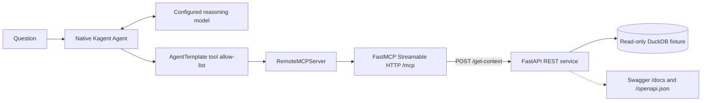

# Graph retrieval through a bounded MCP tool

This lab lets a Kagent agent retrieve a small, known topology through the same REST-to-MCP boundary planned for the remote data service.

The adapter exposes exactly `get_graph_context(query, context_size)`. `context_size` limits the combined number of entities and views to 1..10. Relationships reference only returned objects. A response includes an explicit source, environments, groupings, completeness, truncation and limitations. Empty-result human context repeats source/scope so a limitation does not imply the source was never queried. A five-second adapter deadline and 32 KiB upstream body ceiling apply before parsing. Tests check the complete MCP response envelope against 64 KiB.

The fixture contains production and development namespaces, workloads, policy findings, teams and views. Each environment has both compliant and non-compliant examples. Fixed parameterized DuckDB queries retrieve graph metadata. No SQL supplied by the caller is accepted. This is deterministic lexical retrieval over explicit nodes and edges, not an Apache AGE or embedding implementation.

REST and MCP run in separate Deployments. The database is seeded at image build and read-only at runtime. Neither pod receives a Kubernetes service-account token. The pods run as a non-root user with a read-only root filesystem. ClusterIP Services have no public ingress. NetworkPolicies describe allowed REST/MCP/DNS traffic. A CNI that enforces NetworkPolicy is required to claim network isolation; applying the objects on Kind's default kindnet does not prove enforcement.

The native Kagent runtime mediates the registered MCP connection. This bundle uses that existing route rather than installing another AgentGateway. The lab's existing model route is reused by reference. Model credentials stay in the lab. The AgentTemplate selects one MCP tool; actual discovery and invocation traces must confirm it. The adapter itself exposes no other capability.

The graph supplies evidence about relationships. The model still has to respect scope and limitations. Integration acceptance tests check facts, citations, unsupported requests and real tool calls. They do not measure hallucination reduction or token savings. Those claims need equivalent questions, a graph-free baseline, repeated runs and end-to-end token telemetry.

The supplied `/get-context` shape is a local compatibility target inferred from the brief. The actual remote OpenAPI has not been supplied. Remote schema, authentication, scope semantics and graph quality remain separate acceptance gates.

References checked during this build:

- https://kagent.dev/docs/kagent/1.x/get-started/your-first-mcp-tool/
- https://gofastmcp.com/deployment/running-server
- The installed native alpha17 CRD schemas. These govern the rendered resources when documentation differs.

## Native runtime recovery in this run

The first native invocation failed before reaching the model. A read-only check found that the default worker's registered IP was stale after the resumed Kind environment, while its live pod had a different IP. Router connection probes targeted that old address; the actor's HTTP/2 and health endpoints were reachable through its actual worker namespace. This is a runtime routing failure, not a REST or MCP failure.

The bundle provides an optional dedicated WorkerPool and Harness, including the native worker-pool selection labels. This creates a fresh registration without restarting or rewriting shared workers. It leaves the shared registration discrepancy open. The next native invocation reached the configured Kimi route and returned a provider quota error. These two failure receipts are preserved separately.

An optional Ollama/Qwen deployment supplies local inference in the lab namespace. Any successful acceptance using it proves that explicitly named local model route. It does not prove the Kimi route or a production model comparison. The native tests inspect actual calls and facts regardless of the chosen model.
