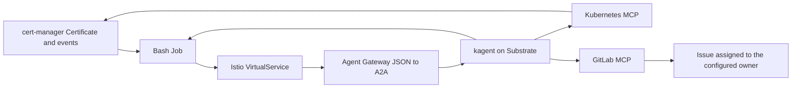

# Namespace incident triage with kagent and GitLab MCP

The [office handoff](START-HERE.md) includes the scheduled implementation,
editable MkDocs site and interactive presentation. This page records the
original certificate-specific demo.

A Kubernetes Job detects a real cert-manager failure in its application
namespace and posts a short JSON incident through Istio. Agent Gateway wraps
it as an A2A 1.0 `SendMessage` to kagent 1.0.1 on Substrate 1.0.0.
The agent calls the namespace-scoped Kubernetes MCP tool
`get_certificate_health` to inspect the source. The tool returns a bounded set
of Certificate and Issuer fields. The agent then invokes a separate GitLab
MCP tool to prepare or ensure an assigned issue.



## Run the no-Argo path

Use a dedicated lab context with Kubernetes 1.37, kagent 1.0.1, Gateway API
v1.4.1, Agent Gateway 1.7.0, Istio 1.30.8 with a ClusterIP `lab-ingress`
release, and cert-manager v1.21.3. Kubernetes 1.37 serves PodCertificateRequest
and ClusterTrustBundle by default. Use the official kagent installer and the
included values to enable the default Substrate harness with the bundled tool
server disabled.

For a new kind cluster, install the pinned dependencies once against its
kubeconfig. Confirm the context and external registry resolution first.

```bash
context="{{LAB_KUBE_CONTEXT}}"
export KUBECONFIG="{{LAB_KUBECONFIG}}"
kubectl --context "$context" api-resources --api-group=certificates.k8s.io
kubectl --context "$context" apply --server-side -f \
  https://github.com/kubernetes-sigs/gateway-api/releases/download/v1.4.1/standard-install.yaml
helm --kube-context "$context" upgrade --install agentgateway-crds \
  oci://cr.agentgateway.dev/charts/agentgateway-crds --version v1.7.0 \
  -n agentgateway-system --create-namespace
helm --kube-context "$context" upgrade --install agentgateway \
  oci://cr.agentgateway.dev/charts/agentgateway --version v1.7.0 \
  -n agentgateway-system --wait
helm repo add istio-incident https://istio-release.storage.googleapis.com/charts
helm --kube-context "$context" upgrade --install istio-base istio-incident/base \
  --version 1.30.8 -n istio-system --create-namespace
helm --kube-context "$context" upgrade --install istiod istio-incident/istiod \
  --version 1.30.8 -n istio-system --wait
helm --kube-context "$context" upgrade --install lab-ingress istio-incident/gateway \
  --version 1.30.8 -n istio-system --set service.type=ClusterIP --wait
helm --kube-context "$context" upgrade --install cert-manager \
  oci://quay.io/jetstack/charts/cert-manager --version v1.21.3 \
  -n cert-manager --create-namespace --set crds.enabled=true --wait
```

Set that context as current in the dedicated kubeconfig before running the
kagent CLI installer.

```bash
test "$(kubectl config current-context)" = "$context"
OLLAMA_API_KEY=lab-placeholder kagent --config kagent-install.yaml install --profile minimal
kubectl --context "$context" apply --server-side -f model.yaml
kubectl --context "$context" -n kagent rollout status deployment/incident-model --timeout=600s
kubectl --context "$context" create namespace certificate-lab --dry-run=client -o yaml |
  kubectl --context "$context" apply --server-side -f -
openssl rand -hex 32 | tr -d '\n' |
  kubectl --context "$context" -n kagent create secret generic incident-mcp-key --from-file=key=/dev/stdin
kubectl --context "$context" apply -k . --server-side --dry-run=server
kubectl --context "$context" apply -k . --server-side
kubectl --context "$context" -n kagent wait agent/namespace-incident --for=condition=Ready --timeout=420s
kubectl --context "$context" -n certificate-lab get events --field-selector reason=IssuerNotFound
```

The included kagent values are for a single-controller lab. Under heavy VM
load, the test also used the following lab-only overrides to keep Agent Gateway
and the bundled PostgreSQL running through slow Kubernetes API and exec probes.
The fresh kind scheduler and controller manager also ran as single instances
with leader election disabled after lease renewals timed out.

```bash
kubectl --context "$context" -n agentgateway-system patch deployment agentgateway \
  --type merge -p '{"spec":{"strategy":{"type":"Recreate","rollingUpdate":null}}}'
kubectl --context "$context" -n agentgateway-system set env \
  deployment/agentgateway AGW_DISABLE_LEADER_ELECTION=true
kubectl --context "$context" -n kagent patch deployment kagent-postgresql --type strategic \
  -p '{"spec":{"template":{"spec":{"containers":[{"name":"postgresql","livenessProbe":{"timeoutSeconds":10,"failureThreshold":6},"readinessProbe":{"timeoutSeconds":10,"failureThreshold":5}}]}}}}'
```

The lab uses a checksum-verified Qwen3 1.7B model served locally by llama.cpp.
The fixture starts with an unready Certificate that points to a deliberately
missing namespaced Issuer. This cert-manager version emits `IssuerNotFound`
as a Normal event. Bash requires both the unready Certificate and a relevant
event correlated by Certificate UID or owned CertificateRequest UID. It sends
only allowlisted identifiers, severity and reason.

Run one Job and inspect its logs. For a live-read check, place a random marker
on the Certificate before the run. The scanner does not include the marker.
Compare the marker in the completed A2A receipt with the original value and
check the GitLab MCP server log for the same incident ID.

```bash
marker="$(openssl rand -hex 8)"
kubectl --context "$context" -n certificate-lab annotate --overwrite \
  certificate/application-tls "triage.lab/read-proof=$marker"
job="$(kubectl --context "$context" create -f job.yaml -o name)"
kubectl --context "$context" -n certificate-lab wait "$job" --for=condition=complete --timeout=360s
kubectl --context "$context" -n certificate-lab logs "$job"
kubectl --context "$context" -n kagent logs deployment/incident-gitlab-mcp
```

## Issue creation and ownership

The agent calls `ensure_gitlab_incident_issue()`. The tool
independently checks the Certificate and Issuer and recomputes the incident ID.
The source Certificate, project and numeric assignee come from operator configuration. In
preview mode it produces a receipt without a GitLab request. The default
preview assignee of `1` is a placeholder.

The Bash Job gets ticket status from the GitLab MCP service’s read-only
receipt endpoint. It accepts a receipt only for this incident, recorded at
or after dispatch. A verified receipt completes the ticket handoff even
when the agent's HTTP response times out. The Job records that timeout
in its separate triage field. The lab keeps the latest receipt in memory
and runs one replay at a time. A restart clears that receipt. Durable storage and caller
authentication belong in the shared deployment.

To activate a real GitLab project, configure a short-lived **Issues Read/Create**
credential restricted to that approved private project. Put `GITLAB_URL`
(HTTPS origin only), `GITLAB_PROJECT_ID` (numeric), and `GITLAB_TOKEN` into the
`kagent/incident-gitlab` Secret via the approved secret-management path. Set
`GITLAB_ASSIGNEE_ID` and `TICKET_MODE=gitlab` in the MCP Deployment settings.
Use an authenticated private HTTPS MCP route for shared use. The dedicated lab
MCP uses a Secret-backed header supplied by the Substrate egress gateway.

One replica serializes issue handoffs. The tool checks for the fingerprint
label before creating an issue, then reads it back and verifies the project,
label, confidentiality and assignee. Ambiguous writes require reconciliation
before submitting another run. The Bash Job has no GitLab credential.

## Recovery and the desired source-cluster deployment

Repair the throwaway Certificate and run the Job again. The healthy run
should skip the agent and the ticket tool.

```bash
kubectl --context "$context" -n certificate-lab patch certificate application-tls \
  --type merge --patch-file recovery-patch.json
kubectl --context "$context" -n certificate-lab wait certificate/application-tls \
  --for=condition=Ready --timeout=180s
kubectl --context "$context" create -f job.yaml
```

For Connect, run the scanner in the opted-in source namespace and give the agent
a private, authenticated route to a namespace-scoped Kubernetes MCP endpoint
there. Bind the agent and ticket source check to the Connect identity through
operator-owned configuration. The lab MCP services check the local cluster.
For new critical log or downtime rules, send short allowlisted facts and keep
raw logs in the source log store. Put durable claims, budgets and dispatch
timeouts in front of the agent before running continuously.

Jev can replace the Bash decision later. Both classifiers would emit the same
incident contract with a typed reason and classifier provenance. Jev's result
would still pass the caller's eligibility, namespace, severity and budget checks.

The direct path has no Argo dependency. A ticket depends on the agent reaching
GitLab MCP. The Job receipt exposes an unavailable agent or handoff. If ticket
delivery must survive model or runtime downtime, use an independent durable
handoff. An earlier lab control used Argo to produce a ticket preview while the
agent endpoint was unavailable.

Run `python3 -B verify-local.py` for the classifier and issue API fixture tests.
Use the valid live A2A task, source-read marker, matching GitLab MCP receipt and
GitLab issue read-back as separate acceptance checks. The static lab uses
ClusterIP listeners. Workplace activation requires authenticated ingress,
restricted egress, and approved source and GitLab identities.


## Proxmox evidence so far

On 19 November 2026, the Bash Job reached a terminal kagent A2A task through
Istio and Agent Gateway with Argo scaled to zero. The kagent worker called
Kubernetes MCP and returned the private Certificate marker along with the
missing-Issuer finding. The GitLab MCP service separately rejected an
unauthenticated request and produced an authenticated issue preview. A separate
healthy Certificate issued successfully, and the Bash Job skipped dispatch.
An earlier Argo control produced a preview during an agent outage.

A later no-Argo replay reached both MCP tools in one completed A2A task.
The GitLab MCP log recorded a successful preview for the same incident.
The model described the ticket as unavailable, so the Job's former
model-based check failed. The receipt-backed replay read a fresh preview
for the same incident even though Agent Gateway returned HTTP 504. Local
fixtures verify the final Job exit rule for that response and reject a
missing or stale receipt. The deployed scanner's read-back matched the local
script's SHA-256. The original Certificate was then restored to the
`lab-selfsigned` Issuer and observed at `Ready=True`. The final exit rule
was validated with fixtures before recovery.

GitLab issue creation and a separate Connect MCP target remain receiving-system
checks.

## Scheduled application scanner

See [the scheduled application scanner](scheduled/README.md) for the
per-application CronJob, generic log and event collection, persistent
deduplication, rolling incident budget and reviewable ignore suggestions.
The original single-fault demo above remains available as an isolated replay.
