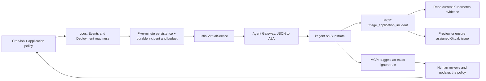

# Scheduled application incident scanner

The scanner runs in the monitored application's namespace every five minutes.
It watches the chosen Deployment's availability, the selected controller
container's error logs, and Kubernetes Warning events attached to that Deployment
or its Pods and ReplicaSets. It runs the same checks for every application
profile. The example profile is for the cert-manager controller.



## What qualifies

- **Application health.** Fewer available replicas than requested is a readiness
  signal. Zero available replicas with a positive desired count is critical.
  Deliberate scale-to-zero is paused. The scanner waits for the Deployment
  controller to observe the current generation.
- **Logs.** It recognizes structured JSON levels, leading text levels, logfmt
  levels and Kubernetes klog error/fatal prefixes. It reads the configured
  container in owned Pods, including the previous instance when it is available.
  The signal is a hash of a stable error code or normalized message. An
  application can add named regex rules for formats that omit a standard level.
- **Events.** Any fresh Warning reason in scope can qualify. The application
  can name additional objects in the namespace and admit specific Normal
  reasons. For example, opt in to a named Certificate and the
  `IssuerNotFound` reason. An old event whose occurrence timestamp hasn't
  advanced is counted once.
- **Persistence.** A signal needs fresh evidence in at least two completed
  scans separated by five minutes or more. A long observation gap starts that
  signal's timer again. With a 15-minute schedule confirmation takes longer.

The payload contains application identity, readiness counts, signal IDs and
timestamps. Raw log lines, event messages and credentials stay out of A2A,
MCP results, tickets and the durable state.

## What keeps it quiet

One application incident groups the currently observed signals and reserves
one dispatch. A still-open incident stays quiet even if another symptom
appears. After all tracked signals have been quiet for 15 minutes, the next
persistent problem can open a new incident. A rolling 24-hour budget counts
dispatch reservations and admits at most three per application, including
critical incidents.

The scanner writes its ConfigMap using Kubernetes `resourceVersion` before
posting. A competing Job loses that write and sends nothing. A stopped Job
or an ambiguous HTTP outcome still consumes the reservation, so nothing
automatically replays it. Check the durable ticket outcome or reconcile the
handoff manually. An unconfirmed handoff is a failed Job, with the incident
ID in its logs. A ticket receipt can confirm the handoff even if the A2A
transport outcome is unknown. The Job polls briefly for a delayed receipt.

The CronJob skips an overlapping scheduled run while a prior Job finishes
its bounded handoff and receipt check. The ConfigMap check also covers
manually launched Jobs sharing the same application state. Keep both runtime
ConfigMaps outside declarative reconciliation so repo changes cannot reset
the incident history or budget.

## Teach one application what to ignore

Edit [policy.json](policy.json) and apply the overlay. Each application gets
its own policy, CronJob, runtime ConfigMaps, destination route and owner.
The minimum bindings are its namespace, exact Deployment and container, label
selector, logical cluster ID, and GitLab project and numeric assignee. When
copying the overlay, keep object names, RBAC bindings, route hostname/path and
kagent names unique and update their references together.

| Policy field | Use |
| --- | --- |
| `log_rules` | Named application-specific patterns such as `{"id":"database-offline","pattern":"database ring is unavailable"}`. Names are visible during investigation. |
| `ignore_log_patterns` | Operator-owned patterns evaluated against local log lines before any classifier runs. |
| `ignore_signals` | Exact signatures, for example `event:ExpectedLeaderElection` or a reviewed `log:<hash>`. Readiness cannot be disabled through this list. |
| `extra_event_reasons` | Explicit Normal event reasons to treat as operational signals. |
| `related_event_objects` | Named namespaced objects, for example `{"kind":"Certificate","name":"application-tls"}`. |

During investigation, `triage_application_incident` reads current Kubernetes
evidence and records the ticket through a single MCP call. If the source
inspection fails, the tool records the ticket from the admitted evidence and
reports that the live inspection was unavailable. `propose_ignore` can record one recommendation for
an exact admitted log/event signature. It requires the Deployment to be
fully available at admission and at proposal time. It records a reason and
`pending-review` in the outcomes ConfigMap. It cannot edit the policy or the
application. Review the evidence, then add the exact signal to
`ignore_signals` if it is safe to suppress. The next Job uses the new rules.

For an unfamiliar hashed log signature, review the application logs at the
reported times. To check a candidate interactively, paste its message without
the Kubernetes timestamp into this command from this directory:

```bash
python3 -B -c 'import scanner, sys; value = scanner.log_signature(sys.stdin.readline().strip()); print("log:" + value if value else "unclassified")'
```

## Install in the dedicated lab

The gateway overlay reuses the original lab's `kagent/namespace-incident`
Gateway infrastructure, `lab-ingress` Service, model, default Substrate
harness, and `kagent/incident-mcp-key` Secret. It installs its own route,
agent and MCP service. Leave the target GitLab service in preview while
checking the integration. Do this from the scheduled directory.

```bash
context="{{LAB_KUBE_CONTEXT}}"
kubectl --context "$context" -n cert-manager get deployment cert-manager
kubectl --context "$context" -n kagent get gateway namespace-incident
kubectl --context "$context" -n kagent get secret incident-mcp-key -o name

# Initialize once. These create commands deliberately fail if state exists.
kubectl --context "$context" -n cert-manager create configmap cert-manager-incident-state \
  --from-literal=state.json='{"version":1}'
kubectl --context "$context" -n cert-manager create configmap cert-manager-incident-outcomes \
  --from-literal=outcomes.json='{}'

kubectl --context "$context" apply --server-side --dry-run=server -k .
kubectl --context "$context" apply --server-side -k .
kubectl --context "$context" -n kagent wait agent/cert-manager-incident-triage \
  --for=condition=Ready --timeout=420s
kubectl --context "$context" -n kagent rollout status deploy/cert-manager-incident-mcp

job="cert-manager-incident-smoke-$(date +%s)"
kubectl --context "$context" -n cert-manager create job "$job" \
  --from=cronjob/cert-manager-incident-scanner
kubectl --context "$context" -n cert-manager wait "job/$job" --for=condition=Complete --timeout=430s
kubectl --context "$context" -n cert-manager logs "job/$job"
kubectl --context "$context" -n cert-manager get configmap cert-manager-incident-outcomes \
  -o jsonpath='{.data.outcomes\.json}'
```

The committed manifest starts suspended. When the preview path has been
checked, set `spec.suspend` to `false` in the overlay and apply it. A 15-minute
profile can set the schedule to `*/15 * * * *`. The per-app maximum gap
must accommodate the interval.

Live mode uses the application owner's approved GitLab project and assignment.
Provide the approved credential through `cert-manager-incident-gitlab`
with `GITLAB_URL`, `GITLAB_PROJECT_ID` and `GITLAB_TOKEN`. Set
`GITLAB_ASSIGNEE_ID` and `TICKET_MODE=gitlab` on the MCP Deployment
configuration. Use the project's documented
[GitLab assignment field](https://docs.gitlab.com/api/issues/#create-an-issue)
via `GITLAB_ASSIGNMENT_FIELD` (`assignee_id` or `assignee_ids`). The tool
verifies the confidential issue, incident label and assignee by reading the
created or existing issue back. An ambiguous create requires reconciliation.

## Bounds and checks

- The lab poller targets one Deployment and container per profile. Log access
  is namespaced, while application ownership is verified against the
  Deployment/ReplicaSet/Pod chain. Per-Pod log sampling cannot recover logs
  that have expired or disappeared with deleted Pods.
- Scan limits are eight matching Pods, 400 lines per container log stream,
  four pages per list and 128 simultaneously tracked signatures. A collection
  failure leaves admission unchanged. An app with high-volume or durable
  telemetry needs a log/event backend rather than increasing CronJob limits.
- The lab uses internal HTTP and a Secret-backed MCP header. Use authenticated
  gateway ingress and protected transport and bind Kubernetes MCP to the
  approved source cluster for a shared deployment. The example reads the
  local cluster.
- Run `python3 -B -m unittest -v test_scheduled` and `kubectl kustomize .`.
  Test the routing and receiving-system issue creation separately.

## Verification on 19 November 2026

- The full overlay passed server dry-run with the lab's kagent 1.0.1,
  Agent Gateway 1.7.0, Gateway API 1.4.1 and Istio 1.30.8 schemas.
- In disposable Kubernetes 1.35, a healthy control returned `clear`.
  The first poll found a controller error and a related Warning event and
  returned `waiting-for-persistence`. The five-minute CronJob fired on its
  own schedule. With a fresh event and log more than five minutes after
  their first observation, a subsequent Job sent one incident.
- A fixture ingress called the actual scoped MCP service. It recorded one
  assigned preview and a `pending-review` suggestion. The next scanner Job
  saw the two ongoing signals and returned `already-dispatched`. The
  service rejected calls without authentication or an admitted ID.
- Fifteen local tests cover source scope, policy, persistence, the rolling
  cap, concurrent admission, transport and ticket receipt handling, and
  GitLab issue/assignment read-back through a mocked API. The original
  single-fault fixture also passes.

## Home-lab trial on 19 November 2026

The native home-lab trial used Kubernetes 1.37, cert-manager 1.21.3, kagent
1.0.1 on Substrate 1.0.0, and the existing Istio and Agent Gateway route.
The Argo server and workflow controller each had zero replicas. The trial
registered two throwaway CertificateRequests as related objects and opted
into cert-manager's Normal `IssuerNotFound` reason.

The healthy control was clear. The CronJob fired on schedule and held the
first signal before the five-minute threshold. A fresh occurrence later
produced one reservation. The Agent Gateway path reached kagent and its
Kubernetes MCP call. The initial Job marked the ticket unconfirmed when the
gateway timed out. The matching assigned preview appeared later in the
durable outcome record. The next scan suppressed the open incident.

A test-only ignore rule cleared the signal without deleting that original
reservation or resetting its 24-hour budget. The next fault had its own
reservation, and its duplicate scan also stayed quiet. The first attempt
with the combined MCP tool reported tool errors and did not leave a
matching preview at read-back. The scanner now checks for a late matching
receipt without issuing another HTTP request.

A controlled, preview-only replay used the second incident's existing
reservation and the live gateway. The replay also reported the handoff
unconfirmed. Its read-back contained the first incident's preview and no
matching result for the second. During the test, the cluster API reported
timeouts and intermittent authorization errors, and the VM recorded
sustained disk I/O and memory pressure. The revised end-to-end run and
actual GitLab issue creation were unconfirmed in that recorded run. The
bundle owner later confirmed that the workflow was complete and tested.
The [office handoff](../START-HERE.md) preserves both evidence records.
Receiving-project issue creation and assignment have their own acceptance.

The final cleanup removed the temporary certificates and ignore-rule fixture,
restored the default profile, and verified the CronJob was suspended. The
original control Certificates remained Ready and both Argo Deployments
remained scaled to zero.
