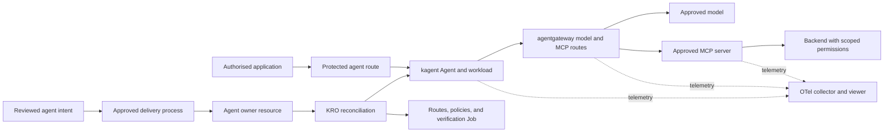

# How the agent platform works

KRO reconciles the agent's resource graph. kagent configures and runs the agent workload. agentgateway handles the configured model, MCP, and agent traffic and applies policies on those routes. Kubernetes controllers run the Deployments, Pods, and Jobs beneath them. These are separate responsibilities, rather than three copies of the same controller.

The exact generated objects and routing depend on the installed graph. Inspect the live resources rather than treating this diagram as an inventory.

## Delivery and application integration

Application code can remain in the team's existing ADO repository. That repository is separate from the platform controllers and policy configuration. An application needs an approved endpoint, caller identity, audience, and route policy. The repository location alone grants no access.

Permanent changes follow the receiving platform's reviewed delivery process, normally GitOps. The reference terminal demo has an explicit create action for one dedicated demo slot. It illustrates controller reconciliation without replacing the organisation's production delivery process.

The reference graph owns container hardening, approved model and tool choices, routes, and verification. The owner submits bounded intent. A model-only PONG verifies the model path. It does not verify an MCP operation. Current classic intent fields are immutable, so an amendment needs an approved migration or controlled recreate and fresh verification.

## Pick the technical depth

1. Use [demo 1](01-ONBOARD-AN-AGENT.md) for deployment, ownership, reconciliation, and the generated YAML.
2. Use [demo 2](02-TEST-SECURITY.md) for hardening, application access, caller rejection, and tool permissions.
3. Use [demo 3](03-FOLLOW-A-TOOL-CALL.md) for runtime evidence, a real tool operation, and telemetry.

The classic demo uses a normal Deployment runtime. Some OTel integration profiles and their HTTPS acceptance verifier require Agent Substrate. Use a compatible observer for the selected runtime. Do not introduce Substrate or claim its lifecycle just to make a verifier pass.

## Compare the use cases accurately

The documentation assistant described in the meeting focuses on retrieving guidance and answering questions. These demonstrations focus on agents that invoke approved tools against operational systems. A real read-only Kubernetes query is the bounded example here.

Grafana, ServiceNow, repository updates, and merge-request creation are integration examples. Each needs its own adapter, identity, permissions, and evidence. This pack does not establish that every integration is deployed or authorise write operations. RAG can also be one tool within an operational agent. The distinction is the demonstrated workflow and permissions, rather than the chat interface or a blanket claim about Copilot products.

"Copilot harness in production" is unresolved terminology. Ask which product or framework they mean and whether the question concerns execution, hosting, security, or operational support.

## Inspect upstream code

- KRO: https://github.com/kubernetes-sigs/kro
- kagent: https://github.com/kagent-dev/kagent
- agentgateway: https://github.com/agentgateway/agentgateway

Use source matching the installed versions when answering implementation questions. The local verifier, protected A2A client, and tool adapters provide smaller code examples when the team wants an integration-focused session.
